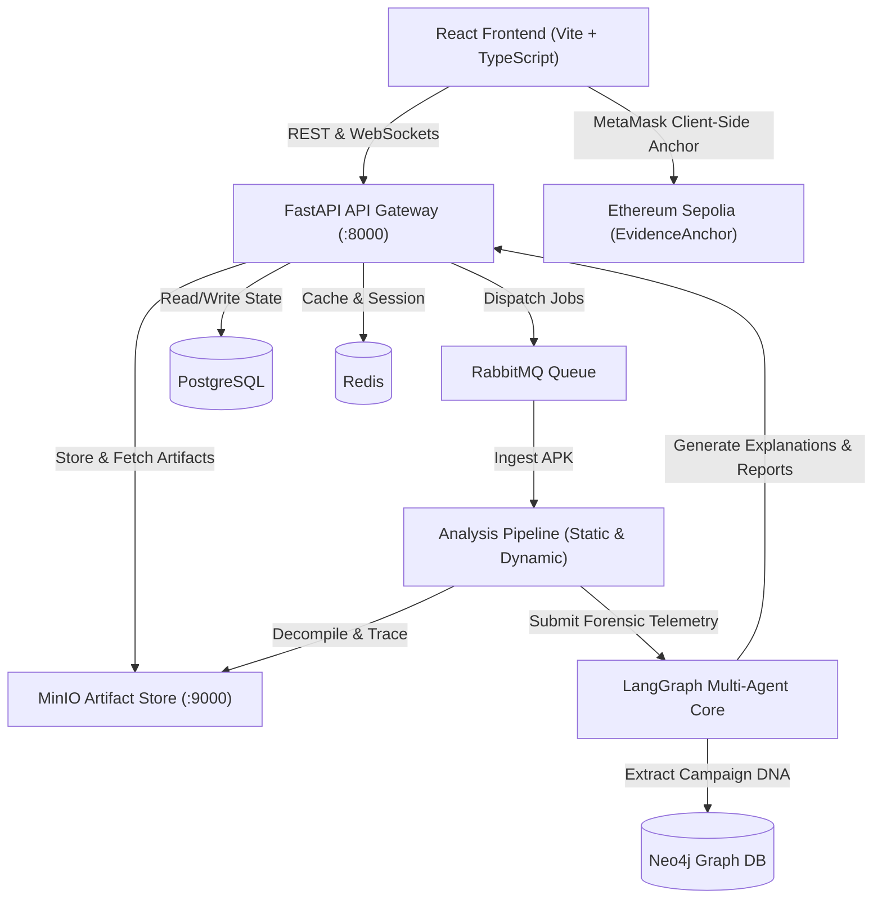

# Tracelock

> **AI-Powered Android Malware Forensics & Banking-Fraud Intelligence Platform**

Tracelock automates end-to-end forensic investigation of suspicious Android application packages (APKs) distributed via SMS, messaging apps, and phishing vectors. Designed specifically to counter banking trojans, SMS/OTP interceptors, and credential-harvesting threats targeting financial institutions and customers, Tracelock accelerates the pipeline from sample upload to verifiable, evidence-backed forensic intelligence.

---

## Key Capabilities

- **Automated Static & Dynamic Forensics**: DEX decompilation, manifest inspection, permissions risk profiling, API call analysis, and runtime behavioral monitoring.
- **Multi-Agent Intelligence Core (LangGraph)**: Specialized GenAI agents operating in sequence for bytecode de-obfuscation, MITRE ATT&CK technique mapping, network infrastructure intelligence, regulatory GRC compliance, and unified synthesis.
- **Explainable Threat Index (0–100)**: Transparent weighted risk scoring attributing concrete evidence to every score component—no black-box verdicts.
- **Multi-Persona Role-Based Views (RBAC)**: Tailored operational dashboards and reports for 5 distinct roles:
  - **Security Analyst**: In-depth decompilation, decompiled source tree, network graph, ATT&CK matrix.
  - **Bank Officer**: Financial fraud impact, affected accounts, account freeze recommendations, risk score.
  - **Legal / Auditor**: Tamper-evident chain of custody, statutory compliance, audit trail.
  - **Citizen / Public**: Plain-language consumer warnings and safety advice in multiple regional languages.
  - **System Administrator**: Worker telemetry, queue health, container status, and audit logs.
- **Multilingual Incident Advisories**: Generates stakeholder advisories in English, Hindi (हिन्दी), Telugu (తెలుగు), Tamil (தமிழ்), Kannada (ಕನ್ನಡ), and Malayalam (മലയാളം).
- **Blockchain Evidence Anchoring**: SHA-256 evidence digests cryptographically anchored via Ethereum Sepolia smart contracts (`EvidenceAnchor.sol`), ensuring auditable, tamper-proof chain of custody with client-side MetaMask signing.

---

## System Architecture



---

## Tech Stack

| Layer | Technologies |
|---|---|
| **API Gateway & Core** | FastAPI, Python 3.11+, SQLAlchemy (asyncpg), Pydantic v2, Uvicorn |
| **Agent Orchestration** | LangGraph, Groq, Google Generative AI, Ollama |
| **Static & Dynamic Analysis** | Androguard, APKInspector, JADX, LibPango/Cairo |
| **Frontend UI / SOC** | React 19, Vite, TypeScript, TailwindCSS, @xyflow/react (React Flow), Recharts, Lucide React, Framer Motion, i18next |
| **Data & Storage** | PostgreSQL 16, Redis 7, Neo4j 5, MinIO S3 Object Store |
| **Messaging & Queues** | RabbitMQ 3 (AMQP) |
| **Integrity & Web3** | Solidity 0.8.20 (`EvidenceAnchor.sol`), Ethers.js v6 |

---

## Repository Structure

```
tracelock/
├── backend/                  # FastAPI application & LangGraph agents
│   ├── app/
│   │   ├── api/v1/          # Endpoints: auth, cases, reports, uploads, etc.
│   │   ├── core/            # Config, security, DB engine, middleware
│   │   ├── models/          # SQLAlchemy relational models
│   │   ├── schemas/         # Pydantic validation schemas
│   │   └── services/        # LangGraph agents, risk engine, forensic processors
│   ├── prompts/             # System prompts for specialized AI agents
│   ├── tests/               # Backend test suite (pytest)
│   └── requirements.txt     # Python backend dependencies
├── frontend/                 # Vite + React 19 + TypeScript web application
│   ├── src/
│   │   ├── components/      # Threat graphs, dashboards, report viewers
│   │   ├── context/         # Auth, language, theme providers
│   │   ├── pages/           # Analyst, Officer, Auditor, Public, Admin pages
│   │   └── services/        # API client, Web3/MetaMask integration
│   └── package.json
├── contracts/                # Ethereum smart contracts
│   └── EvidenceAnchor.sol   # On-chain SHA-256 evidence anchoring
├── docker/                   # Dockerfiles for backend and frontend
│   ├── backend.Dockerfile
│   └── frontend.Dockerfile
├── docs/                     # Detailed architectural and functional documentation
│   ├── ARCHITECTURE.md      # Full architecture specifications
│   ├── API_REFERENCE.md     # REST and WebSocket API schemas
│   ├── FEATURES.md          # Feature requirements and acceptance criteria
│   ├── AI_AGENTS.md         # LangGraph multi-agent pipeline
│   ├── RISK_ENGINE.md       # Threat Index formulation
│   ├── REPORT_ENGINE.md     # Multi-persona report compiler
│   └── DATABASE_SCHEMA.md   # PostgreSQL schema & RLS rules
├── scripts/                  # Synthetic dataset & utility scripts
├── docker-compose.yml        # Full-stack local orchestration
└── README.md
```

---

## Quick Start

### 1. Prerequisites
- [Docker](https://www.docker.com/) & Docker Compose
- [Node.js](https://nodejs.org/) (v18+) & `npm`
- [Python](https://www.python.org/) (v3.11+)

### 2. Environment Configuration
Copy the sample environment configuration:
```bash
cp .env.example .env
cp frontend/.env.example frontend/.env
```

### 3. Running with Docker Compose (Recommended)
Launch the complete stack (Postgres, Redis, RabbitMQ, Neo4j, MinIO, Backend, and Frontend):
```bash
docker compose up -d
```

- **Frontend SOC Dashboard**: [http://localhost:3000](http://localhost:3000)
- **FastAPI Documentation**: [http://localhost:8000/docs](http://localhost:8000/docs)
- **MinIO Console**: [http://localhost:9001](http://localhost:9001)
- **RabbitMQ Management**: [http://localhost:15672](http://localhost:15672)
- **Neo4j Browser**: [http://localhost:7474](http://localhost:7474)

---

## Local Development Setup

### Backend
```bash
# Navigate to backend
cd backend

# Create virtual environment
python -m venv .venv
source .venv/bin/activate  # On Windows: .venv\Scripts\activate

# Install dependencies
pip install -r requirements.txt

# Run test suite
pytest tests/
```

### Frontend
```bash
# Navigate to frontend
cd frontend

# Install packages
npm install

# Run development server
npm run dev

# Build for production
npm run build
```

---

## Documentation Index

Comprehensive guides for development and operations are located in the [`docs/`](./docs) directory:

- [Architecture Guide](./docs/ARCHITECTURE.md)
- [API Reference & OpenAPI](./docs/API_REFERENCE.md)
- [Feature Specification](./docs/FEATURES.md)
- [AI Multi-Agent System](./docs/AI_AGENTS.md)
- [Risk Scoring Engine](./docs/RISK_ENGINE.md)
- [Multi-Persona Report Engine](./docs/REPORT_ENGINE.md)
- [Database Schema & Models](./docs/DATABASE_SCHEMA.md)
- [Static Analysis Engine](./docs/STATIC_ANALYSIS.md)
- [Dynamic Analysis Engine](./docs/DYNAMIC_ANALYSIS.md)
- [Frontend Development Guide](./docs/FRONTEND.md)
- [Backend Development Guide](./docs/BACKEND.md)

---

## License

This project is licensed under the Apache 2.0 License.
